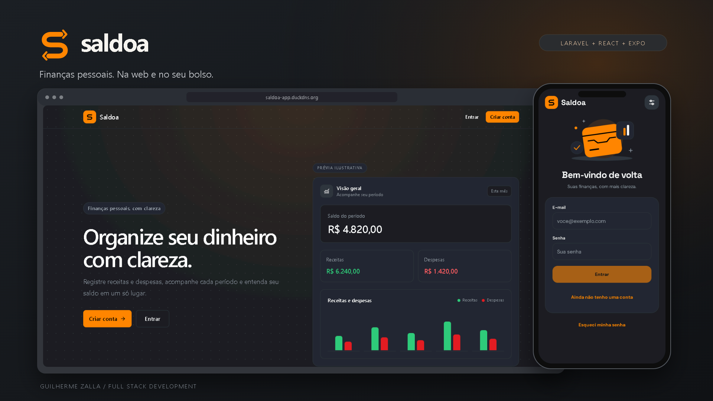

# Saldoa

Projeto de estudo independente e portfólio para controle financeiro pessoal.

**Site:** [Acessar o Saldoa](https://saldoa-app.duckdns.org)

**Android:** [Baixar APK de teste — pré-lançamento](https://github.com/GuilhermeZalla/react-saldoa-app/releases/tag/mobile-v1.0.0-preview.1). Assinatura de depuração e arquitetura ARM64; não destinado à Play Store.

Desenvolvido como uma aplicação web completa com **Laravel 13**, **React 19**, **Inertia.js 3** e **Tailwind CSS 4**, acompanhada por um cliente mobile complementar construído com **Expo (React Native)** e **TypeScript**.

O Saldoa ajuda a acompanhar de perto o fluxo financeiro. O usuário registra receitas e despesas com categorias personalizadas, estipula metas mensais de gastos com indicadores visuais de progresso, agenda lançamentos recorrentes automáticos e visualiza a evolução do patrimônio por meio de gráficos e comparativos em um dashboard interativo. A aplicação conta com separação estrita por usuário, exportação de lançamentos em CSV com sanitização de fórmulas, suporte a exclusão lógica com ação de desfazer e ambiente de demonstração seguro com acesso em um clique.

## Identidade e capa para portfólio

A marca **Fluxo** representa entradas e saídas em um S. [SVG da marca](docs/images/saldoa-logo-01-fluxo.svg) · [Capa PNG em 1920 × 1080](docs/images/saldoa-portfolio-cover.png) · [Capa SVG](docs/images/saldoa-portfolio-cover.svg). A capa combina o site público com o login do cliente Expo no navegador; não representa captura de um aparelho físico.



## Demonstrações

Gravações reais da aplicação em execução no ambiente de desenvolvimento com dados de demonstração. Estas galerias podem mostrar a identidade anterior; a capa acima e o site público já usam a marca Fluxo.

### Visão geral e Landing Page


### Autenticação e Acesso à Demonstração


### Dashboard e Indicadores Financeiros


### Gestão de Lançamentos


### Categorias de Receitas e Despesas


### Planejamento de Metas Mensais


### Aplicativo Móvel (Expo)

Prévia atualizada em 04/11/2026 do cliente Expo no navegador, em uma janela de 390 × 844. As capturas usam respostas simuladas da API com dados fictícios; não representam um teste de login na API real ou das barras nativas do Android.


Capturas individuais: [Login](docs/screenshots/mobile-login-expo.png) · [Cadastro](docs/screenshots/mobile-register-expo.png) · [Dashboard](docs/screenshots/mobile-dashboard-expo.png) · [Lançamentos](docs/screenshots/mobile-transactions-expo.png) · [Formulário de lançamento](docs/screenshots/mobile-transaction-form-expo.png) · [Categorias](docs/screenshots/mobile-categories-expo.png) · [Metas](docs/screenshots/mobile-budgets-expo.png) · [Recorrências](docs/screenshots/mobile-recurring-expo.png) · [Conta](docs/screenshots/mobile-account-expo.png).

O mobile usa uma ilustração vetorial própria no login, ajustes em um painel acessível pelo botão superior e uma conta organizada por grupos de opções. O dashboard destaca o saldo, oferece atalhos e mostra a distribuição das despesas; as metas exibem gasto, limite e valor disponível ou excedido.

A demonstração aparece como o link discreto **Experimentar sem criar conta**, somente quando uma URL demo válida foi configurada no build. A exibição não depende de ser um APK de teste; a instância demo precisa estar disponível e habilitada. Sem essa configuração, o acesso fica oculto.

Preferências e versão em inglês: [Idioma e aparência](docs/screenshots/mobile-preferences-en.png) · [Dashboard em inglês](docs/screenshots/mobile-dashboard-en.png).

> A prévia web é voltada à revisão visual: como o SecureStore não está disponível no navegador, a sessão web fica apenas em memória e é perdida ao recarregar a página. Para testar no celular, use o APK local ou o Expo Go; mudanças em ícones e barras nativas exigem recompilar o APK.

## Screenshots

Capturas reais da aplicação web em português (BRL), extraídas com dados de demonstração. Visualização desktop em proporção widescreen e celular em 390 × 844.

| Tela                  | Desktop                                                  | Celular                                                 |
| --------------------- | -------------------------------------------------------- | ------------------------------------------------------- |
| Início (Landing Page) | [Ver captura](docs/screenshots/home-desktop.png)         | [Ver captura](docs/screenshots/home-mobile.png)         |
| Login / Autenticação  | [Ver captura](docs/screenshots/login-desktop.png)        | [Ver captura](docs/screenshots/login-mobile.png)        |
| Cadastro              | [Ver captura](docs/screenshots/register-desktop.png)     | —                                                       |
| Dashboard Financeiro  | [Ver captura](docs/screenshots/dashboard-desktop.png)    | [Ver captura](docs/screenshots/dashboard-mobile.png)    |
| Lançamentos           | [Ver captura](docs/screenshots/transactions-desktop.png) | [Ver captura](docs/screenshots/transactions-mobile.png) |
| Categorias            | [Ver captura](docs/screenshots/categories-desktop.png)   | [Ver captura](docs/screenshots/categories-mobile.png)   |
| Metas do Mês          | [Ver captura](docs/screenshots/budgets-desktop.png)      | [Ver captura](docs/screenshots/budgets-mobile.png)      |

## Estrutura e stack

- **Backend Web & API:** PHP 8.4, Laravel 13, Laravel Fortify (sessão web), Laravel Sanctum (tokens para API mobile) e Pest PHP.
- **Frontend Web:** React 19, Inertia.js 3, TypeScript, Tailwind CSS 4, componentes shadcn/ui, Recharts e Sonner.
- **Cliente Mobile:** React Native, Expo SDK 58, Expo Router, Expo SecureStore e TypeScript (localizado na pasta `mobile/`).
- **Banco de dados:** SQLite por padrão no desenvolvimento local; suporte e migrations compatíveis com MySQL 8+.
- **Documentação técnica:**
    - `docs/MOBILE_API.md`: especificação dos contratos da API JSON e segurança mobile.
    - `docs/STATUS.md`: acompanhamento do progresso e próximos passos.
    - `docs/apresentacao-entrevista-saldoa.pdf`: guia estruturado em PDF para apresentação técnica em entrevistas.

## Executar localmente

### Requisitos

- **PHP 8.4** com as extensões `pdo_sqlite`, `pdo_mysql`, `mbstring`, `intl`, `bcmath` e `curl`.
- **Composer 2**
- **Node.js 22+** e **npm**
- **Git**
- _(Opcional para mobile)_ Aplicativo **Expo Go** instalado em um smartphone Android ou iOS.

### 1. Backend e Aplicação Web

Clone o repositório e instale as dependências:

```powershell
git clone https://github.com/GuilhermeZalla/react-saldoa-app.git
cd react-saldoa-app
composer install
npm install
```

Configure o ambiente e o banco de dados:

```powershell
Copy-Item .env.example .env
php artisan key:generate
php artisan migrate --seed
```

O arquivo `.env.example` vem pré-configurado para SQLite local (`database/database.sqlite`). Caso queira utilizar MySQL, ajuste as variáveis `DB_CONNECTION`, `DB_HOST`, `DB_DATABASE`, `DB_USERNAME` e `DB_PASSWORD` no `.env`.

Inicie a aplicação e o servidor de assets:

```powershell
composer run dev
```

Abra `http://localhost:8000`. O seeder cadastra dados de exemplo e a conta demo: `demo@exemplo.com` (senha `demo1234`). O acesso rápido em um clique na tela inicial depende de `DEMO_LOGIN_ENABLED=true` no `.env`.

> [!WARNING]
> **A conta e credenciais de demonstração nunca devem existir na base principal de produção.** Em implantações públicas, utilize uma instância de demonstração isolada com `DEMO_INSTANCE=true`. Na produção real, execute `php artisan demo:purge --force` para assegurar que a conta demo não exista.

### 2. Aplicativo Móvel (Expo Go)

O cliente móvel fica na pasta `mobile/` e consome a API JSON do Laravel autenticada via tokens Sanctum:

```powershell
Copy-Item mobile/.env.example mobile/.env
cd mobile
npm install
npm start -- --go --lan
```

Abra o aplicativo **Expo Go** no celular, garanta que o computador e o smartphone estejam na mesma rede Wi-Fi e escaneie o QR Code exibido no terminal.

Para testar contra o backend local a partir de um aparelho físico:

1. Altere `mobile/.env` preenchendo `EXPO_PUBLIC_API_URL=http://<SEU_IP_LAN>:8000` (sem barra no final nem `/api/v1`).
2. No backend, inicie o Laravel com escuta em todas as interfaces: `php artisan serve --host=0.0.0.0 --port=8000`.

Para abrir uma prévia visual no navegador, use `npm run web` dentro da pasta `mobile/`. Essa opção não substitui os testes no Expo Go.

O aplicativo usa a identidade visual do desktop: carteira Saldoa, destaque laranja e fontes DM Sans e Space Grotesk incluídas no pacote, sem depender da internet. Em **Preferências**, disponíveis no login e em **Conta**, escolha **Português / English** e **Claro / Escuro / Sistema**. As escolhas ficam salvas no aparelho (SecureStore); na prévia web, apenas essas preferências usam armazenamento local, enquanto o token permanece em memória. O idioma inicial acompanha o aparelho quando ele usa inglês; nos demais casos, usa português. O tema inicial acompanha o sistema.

O idioma muda os textos e a apresentação de valores e datas; a moeda continua sendo **BRL**, sem conversão. Os campos de data indicam explicitamente a ordem dia/mês/ano nos dois idiomas e enviam ISO para a API. Nomes de categorias e descrições escritos pelo usuário não são traduzidos. Erros de validação da API preservam os detalhes em português; em inglês, o cliente identifica os campos que precisam de correção.

No Android, as barras superior e inferior do sistema ficam ocultas e podem reaparecer temporariamente por gesto. As telas e as abas respeitam as áreas seguras do aparelho, incluindo recortes e navegação inferior. O comportamento exato dos gestos deve ser confirmado no celular; a prévia web não reproduz as barras nativas.

### 3. Gerar um APK local de teste

Com Android Studio, Android SDK e Java instalados, é possível gerar o APK sem conta EAS ou enviar o código para um serviço de build remoto. Configure `EXPO_PUBLIC_API_URL` em `mobile/.env` com o endereço LAN do computador, conectado à mesma rede Wi‑Fi do celular, e inicie a API Laravel aceitando conexões na rede local:

```powershell
cd mobile
npm run apk:local
```

Para servir a API Laravel em uma interface de rede, use a partir da raiz do projeto:

```powershell
php artisan serve --host=0.0.0.0 --port=8000
```

O build permite HTTP **somente para o endereço privado configurado em `EXPO_PUBLIC_API_URL`** e continua bloqueando HTTP para os demais domínios. O arquivo fica em `mobile/android/app/build/outputs/apk/release/app-release.apk`, inclui somente a arquitetura `arm64-v8a` e é assinado com a chave de depuração local: destina-se a testes na sua rede, não à Play Store. Sem URLs públicas, ele não funcionará fora dessa rede. Builds EAS ou AAB de produção exigem configuração de ambientes e assinatura próprios, além de uma API pública HTTPS.

O script usa caminhos curtos no Windows e limita os trabalhos de compilação para reduzir o consumo de memória. O Gradle encerra seu processo ao terminar o build. A primeira compilação pode levar vários minutos; mantenha o IP local configurado atualizado caso ele mude no Wi-Fi.

### APK de teste com a API pública

Para compilar localmente usando a API hospedada, execute no PowerShell a partir da raiz:

```powershell
cd mobile
$env:EXPO_PUBLIC_API_URL = 'https://saldoa-app.duckdns.org'
$env:EXPO_PUBLIC_WEB_URL = 'https://saldoa-app.duckdns.org'
$env:EXPO_PUBLIC_API_URL_DEMO = ''
npm run apk:local -- --public-api
```

Esse modo exige URLs HTTPS e remove a exceção HTTP da rede local. As variáveis valem para a sessão do terminal; `mobile/.env` permanece disponível para desenvolvimento local. O APK pode acessar a API pelo 4G/5G, mas continua sendo ARM64 e assinado com a chave de depuração, sem distribuição pela Play Store. O arquivo gerado é `mobile/android/app/build/outputs/apk/release/app-release.apk`. A API pública usa um banco separado do notebook. Envio real de e-mails ainda está pendente.

## Autenticação, isolamento e segurança

- **Sessão Web vs. Tokens Móveis:** A aplicação web utiliza autenticação baseada em sessão com cookies HttpOnly gerenciados pelo Laravel Fortify e proteção contra CSRF. O cliente mobile utiliza autenticação desacoplada baseada em tokens pessoais via Laravel Sanctum (`Authorization: Bearer <token>`).
- **Isolamento de Dados por Usuário:** 100% das listagens e consultas partem das relações do usuário autenticado (`$user->transactions()`, `$user->categories()`). Policies dedicadas garantem que nenhum usuário acesse ou modifique lançamentos, categorias ou metas de terceiros.
- **Validação com Form Requests:** Todas as operações de criação e alteração passam por Form Requests que validam tipos, formato decimal de moeda, pertencimento da categoria ao usuário e regras de unicidade.
- **Proteção contra Injeção de Fórmulas CSV:** A exportação de dados higieniza campos de texto que se iniciam com caracteres perigosos (`=`, `+`, `-`, `@`), evitando execução indevida de macros em planilhas eletrônicas.
- **Ambiente de Demonstração Seguro:** Na instância de demonstração, o middleware `BlockDemoUserChanges` intercepta e rejeita requisições de escrita originadas pelo usuário demo. O comando `php artisan demo:reset --force` é executado diariamente via Scheduler para restaurar o estado limpo dos dados.

## Regras de negócio

- **Gestão de Lançamentos:** Suporta receitas e despesas vinculadas a categorias do mesmo tipo. Permite filtragem por mês, categoria, tipo e busca textual.
- **Soft Delete e Desfazer:** Exclusões de lançamentos utilizam exclusão lógica (`softDeletes`). A interface web exibe um toast com contagem regressiva de 8 segundos permitindo desfazer a ação instantaneamente.
- **Metas de Gastos (Budgets):** Permite fixar um limite mensal de despesa por categoria. O status é calculado dinamicamente em três faixas:
    - **Ok (< 80%):** gasto sob controle.
    - **Atenção (80% a 99%):** gasto próximo ao limite estipulado (destaque em âmbar).
    - **Excedido (≥ 100%):** limite estourado (destaque em vermelho).
- **Recorrências Automatizadas:** Lançamentos com periodicidade diária, semanal, mensal ou anual são avaliados pelo comando agendado `transactions:generate-recurring`, com bloqueio contra execução sobreposta e idempotência por data de vigência.
- **Dashboard Financeiro:** Exibe saldo atual consolidado, receitas e despesas do mês corrente, indicador percentual de variação em relação ao mês anterior, gráfico em rosca clicável para filtro imediato e gráfico de linha com a evolução semestral.

## API Móvel

Os endpoints JSON utilizam o prefixo `/api/v1` e estão detalhados em [docs/MOBILE_API.md](docs/MOBILE_API.md):

| Método           | Endpoint                              | Acesso         | Descrição                                                          |
| ---------------- | ------------------------------------- | -------------- | ------------------------------------------------------------------ |
| POST             | `/api/v1/auth/register`               | Público        | Cadastro de novo usuário e emissão de token.                       |
| POST             | `/api/v1/auth/login`                  | Público        | Autenticação por e-mail e senha.                                   |
| POST             | `/api/v1/auth/demo`                   | Público (Demo) | Emissão de token de leitura para a conta de demonstração.          |
| GET              | `/api/v1/auth/me`                     | Token          | Dados do perfil do usuário autenticado.                            |
| POST             | `/api/v1/auth/logout`                 | Token          | Revogação do token ativo.                                          |
| GET              | `/api/v1/dashboard`                   | Token          | Métricas consolidadas, alertas e resumo do mês (`?month=AAAA-MM`). |
| GET, POST        | `/api/v1/transactions`                | Token          | Listagem paginada e cadastro de lançamentos.                       |
| GET, PUT, DELETE | `/api/v1/transactions/{id}`           | Token          | Detalhes, atualização e exclusão lógica de lançamento.             |
| POST             | `/api/v1/transactions/{id}/restore`   | Token          | Restauração de lançamento excluído.                                |
| GET              | `/api/v1/transactions/export`         | Token          | Exportação dos lançamentos filtrados em formato CSV.               |
| GET, POST        | `/api/v1/categories`                  | Token          | Listagem e criação de categorias.                                  |
| GET, PUT, DELETE | `/api/v1/categories/{id}`             | Token          | Consulta, edição e exclusão de categoria.                          |
| GET, POST        | `/api/v1/budgets`                     | Token          | Listagem e estipulação de metas de gasto por categoria.            |
| PUT, DELETE      | `/api/v1/budgets/{id}`                | Token          | Atualização de valor ou remoção de meta.                           |
| GET, POST        | `/api/v1/recurring-transactions`      | Token          | Listagem e criação de regras de recorrência.                       |
| PUT, DELETE      | `/api/v1/recurring-transactions/{id}` | Token          | Edição ou cancelamento de regra recorrente.                        |
| GET              | `/api/v1/account/export`              | Token          | Exportação integral de dados do usuário (portabilidade).           |
| DELETE           | `/api/v1/account`                     | Token          | Exclusão definitiva da conta mediante confirmação de senha.        |

## Verificação e qualidade de código

Execute a suíte completa de verificações para assegurar integridade:

```powershell
# Testes automatizados do backend (Pest PHP)
php artisan test

# Formatação e estilo PHP (Laravel Pint)
vendor/bin/pint --test

# Verificação de tipos, linter e formatação do frontend (Vite Plus + TypeScript)
npm run check
npm run types:check
npm run build
```

Para o cliente móvel:

```powershell
cd mobile
npm test
npx expo lint
npx tsc --noEmit
npx expo-doctor
```

## Decisões técnicas

- **Inertia.js com React 19:** Permite criar uma Single-Page Application rica e reativa sem a complexidade de manter rotas, gerenciamento de tokens e validações duplicadas no cliente e no servidor. O roteamento e a autorização permanecem no Laravel.
- **Sanctum Tokens no Mobile:** Diferente do navegador, aplicações móveis não gerenciam cookies de sessão de forma transparente e segura contra políticas cross-site. O uso de tokens Sanctum armazenados no SecureStore do dispositivo oferece segurança e facilidade de renovação.
- **Serviço de Domínio Compartilhado:** O cálculo de progresso das metas e agrupamento de despesas foi centralizado em `BudgetSummaryService`, permitindo que os controllers web (Inertia) e os controllers de API (JSON) consumam exatamente a mesma lógica de negócio sem redundância.
- **Precisão Financeira:** Valores monetários são manipulados no banco com tipo `decimal(12,2)` e expostos na API JSON como strings decimais formatadas (ex.: `"1234.56"`), impedindo erros de ponto flutuante típicos do tipo float em JavaScript.
- **Pest PHP para Testes:** A suíte de testes de integração e feature valida os fluxos reais de ponta a ponta, simulando requisições HTTP, autenticação, autorização entre usuários diferentes e integridade dos cálculos.

## Limites do projeto

- A aplicação ainda não possui implantação pública ativa. A preparação para uma VM AWS EC2, com HTTPS, MySQL persistente, fila, scheduler e backups, está descrita em [Deploy na AWS](docs/AWS_DEPLOY.md); a conta, a VM e o domínio ainda precisam ser configurados. A avaliação gratuita AWS tem prazo/créditos limitados; o serviço não é gratuito permanentemente.
- O aplicativo móvel foi validado no modo desenvolvimento com Expo Go e exportado para Android. O APK local de teste pode ser gerado com `cd mobile; npm run apk:local`; ele inclui somente `arm64-v8a`, usa uma chave de depuração e o endereço HTTP privado da API, e não serve para a Play Store. Builds EAS/AAB de distribuição ainda dependem de configurar URLs públicas HTTPS, assinatura própria, identificador e ícones finais, política de privacidade e página pública de exclusão de conta.
- A recuperação de senha utiliza o fluxo web com envio de e-mails em fila; para envio em produção é necessário configurar um serviço de transporte SMTP transacional.

---

## Uso de Inteligência Artificial

Este projeto foi concebido, arquitetado e desenvolvido de forma independente pelo autor, que é o único responsável pela definição de todas as regras de negócio, modelagem de dados, arquitetura de software e implementação do código-fonte.

Ferramentas modernas de Inteligência Artificial foram utilizadas pontualmente como instrumento de apoio e produtividade nas seguintes atividades complementares:

- **Documentação:** auxílio na elaboração, organização estrutural e revisão gramatical da documentação técnica e deste README.
- **Mockups:** apoio na concepção de protótipos rápidos e exploração de referências visuais de interface.
- **Layout e interface:** sugestões de boas práticas de estilização, apoio na aplicação de classes utilitárias do Tailwind CSS e ajustes de responsividade.
- **Testes automatizados:** apoio na formulação de cenários de borda e revisão de testes de integração com o Pest.

A integridade do sistema, as decisões técnicas, a segurança das regras financeiras e a autoria integral das soluções adotadas permanecem sob responsabilidade do desenvolvedor.
