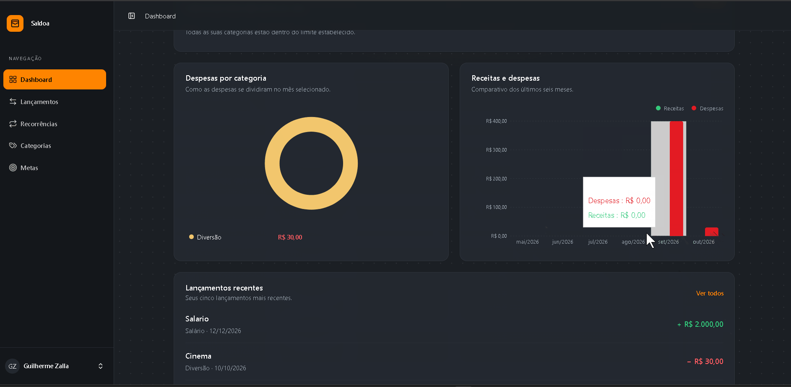
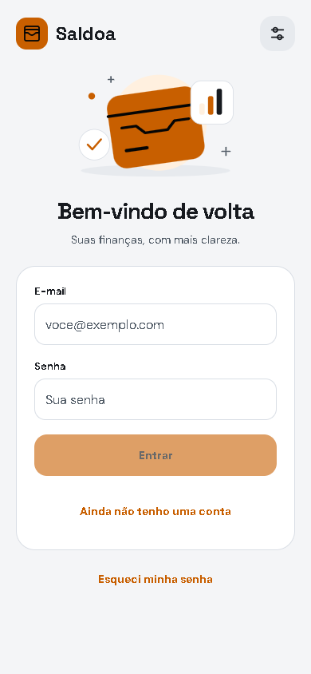
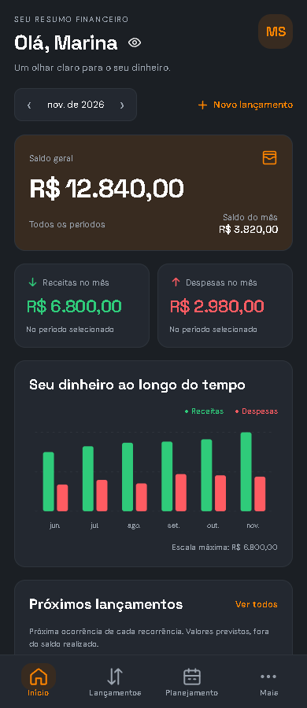
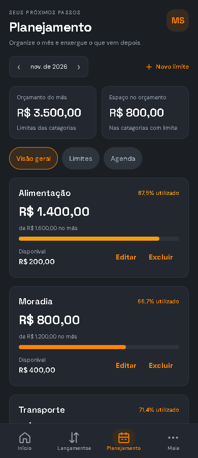

# Saldoa

Personal finance tracking for income, expenses, and budgets, on the web and on your phone.

**[Visit the website](https://saldoa-app.duckdns.org)** · **[Download the Android APK](https://github.com/GuilhermeZalla/react-saldoa-app/releases/download/v1.1.1/saldoa-android-v1.1.1.apk)** · [Release notes](https://github.com/GuilhermeZalla/react-saldoa-app/releases/tag/v1.1.1)

The **web application was completed in 2025**. In **2026**, Saldoa gained a mobile app that shares the same backend. This is a learning and portfolio project, with a live website hosted on AWS and an Android APK available for direct installation.

## Preview


## Features

- Track income and expenses, organized by category.
- View monthly balances, charts, and transactions.
- Set spending budgets by category and track progress.
- Schedule recurring transactions and export your data.
- Manage your profile and delete your account.
- Choose Portuguese or English and light, dark, or system themes in the mobile app.

## Web application



| Screen                 | Desktop                                                 | Mobile browser                                         |
| ---------------------- | ------------------------------------------------------- | ------------------------------------------------------ |
| Home                   | [Screenshot](docs/screenshots/home-desktop.png)         | [Screenshot](docs/screenshots/home-mobile.png)         |
| Sign in                | [Screenshot](docs/screenshots/login-desktop.png)        | [Screenshot](docs/screenshots/login-mobile.png)        |
| Sign up                | [Screenshot](docs/screenshots/register-desktop.png)     | [Screenshot](docs/screenshots/register-mobile.png)     |
| Dashboard              | [Screenshot](docs/screenshots/dashboard-desktop.png)    | [Screenshot](docs/screenshots/dashboard-mobile.png)    |
| Transactions           | [Screenshot](docs/screenshots/transactions-desktop.png) | [Screenshot](docs/screenshots/transactions-mobile.png) |
| Categories             | [Screenshot](docs/screenshots/categories-desktop.png)   | [Screenshot](docs/screenshots/categories-mobile.png)   |
| Budgets                | [Screenshot](docs/screenshots/budgets-desktop.png)      | [Screenshot](docs/screenshots/budgets-mobile.png)      |
| Recurring transactions | [Screenshot](docs/screenshots/recurring-desktop.png)    | [Screenshot](docs/screenshots/recurring-mobile.png)    |
| Account                | [Screenshot](docs/screenshots/account-desktop.png)      | [Screenshot](docs/screenshots/account-mobile.png)      |

## Mobile app

<p>
  
  
  
</p>

The APK connects to the public API over Wi-Fi or mobile data. Your computer does not need to be running. It supports Android ARM64 and is distributed directly through GitHub; it is not on Google Play. See the [mobile guide](mobile/README.md) for installation, development, and build instructions.

The latest stable Android release is [Saldoa 1.1.1, Android version code 12](https://github.com/GuilhermeZalla/react-saldoa-app/releases/tag/v1.1.1). [Download the APK](https://github.com/GuilhermeZalla/react-saldoa-app/releases/download/v1.1.1/saldoa-android-v1.1.1.apk). It includes password visibility controls, tablet sign-in/sign-up layouts, a collapsible sidebar, and corrected dashboard columns. The tablet preview was approved by the author; complete native-device validation remains separate. Google Play and monetization remain pending.

Private screens use sample data. Mobile screenshots were captured in the app's web preview. The web interface is in Portuguese; the mobile app supports Portuguese and English.

## Built with

| Area     | Technologies                                                   |
| -------- | -------------------------------------------------------------- |
| Backend  | Laravel 13, PHP 8.4, and Sanctum                               |
| Web      | React 19, Inertia, TypeScript, and Tailwind CSS                |
| Mobile   | Expo, React Native, and TypeScript                             |
| Database | SQLite for local development; MySQL on AWS                     |
| Hosting  | AWS EC2, Docker Compose, and HTTPS                             |
| Quality  | Pest, static analysis, type checking, lint, and GitHub Actions |

## Run locally

Requirements: PHP 8.4, Composer, Node.js 22.18+ (22.x) or 24.11+ (24.x), and npm. Enable SQLite, OpenSSL, mbstring, intl, and the PHP extensions required by Composer.

For the first installation in a fresh checkout, use PowerShell:

```powershell
composer install
npm ci
if (!(Test-Path .env)) {
    Copy-Item .env.example .env
}
if (!(Test-Path database/database.sqlite)) {
    New-Item database/database.sqlite -ItemType File
}
php artisan key:generate
php artisan migrate --seed
composer run dev
```

Open `http://localhost:8000`. These commands initialize a **local development environment**. Do not run them against production or overwrite an existing environment file.

The local seeder includes `demo@exemplo.com`, password `demo1234`. This account belongs only in local development or a separate demo deployment, never in the main production database.

For mobile development and API configuration, see the [mobile README](mobile/README.md).

## Checks

```powershell
npm --prefix mobile ci
npm run check
npm run types:check
php artisan test --compact
```

Laravel tests use a separate test environment. Mobile-specific checks are documented in the [mobile guide](mobile/README.md).

## Version 1.1.1

Version 1.1.1 completes the tablet improvements in the Android app: responsive sign-in/sign-up screens, a collapsible sidebar, corrected dashboard columns, and password visibility controls. It retains the financial dashboard, transaction history, planning, month navigation, search, pagination, and upcoming recurring transactions introduced in 1.1.0.

See the [changelog](CHANGELOG.md) for the version history and the [latest release](https://github.com/GuilhermeZalla/react-saldoa-app/releases/tag/v1.1.1) for the Android download and release notes.

## Release scope

Version 1.1.0 builds on the web and mobile finance features introduced in 1.0. The public deployment uses HTTPS and Gmail SMTP. Encrypted backups are sent to the owner every 15 days, and recovery was verified in isolated containers using a copy received by email. Releases are deployed manually; pushing to GitHub runs checks but does not update the server.

The Android APK currently uses a debug signing key and supports ARM64 devices. Google Play publishing, distribution signing, and automatic deployment are outside this release's scope.

## Documentation

User guides are available for the desktop website and Android app:

| Platform        | Português                                        | English                                           |
| --------------- | ------------------------------------------------ | ------------------------------------------------- |
| Desktop website | [PDF guide](docs/guia-de-uso-saldoa-desktop.pdf) | [PDF guide](docs/use-guide-saldoa-desktop-en.pdf) |
| Android app     | [PDF guide](docs/guia-de-uso-saldoa.pdf)         | [PDF guide](docs/use-guide-saldoa-en.pdf)         |

The operational guides below are currently written in Portuguese:

- [AWS operations](docs/AWS_OPERACAO.md): server access, logs, database, backups, and costs.
- [AWS deployment](docs/AWS_DEPLOY.md): deployment setup and recovery.
- [Mobile API](docs/MOBILE_API.md): API contracts and integration details.
- [Project status](docs/STATUS.md): delivery records, validation, and remaining work.

## AI assistance

AI tools supported development, review, and documentation. The author remains responsible for project decisions and validation.
