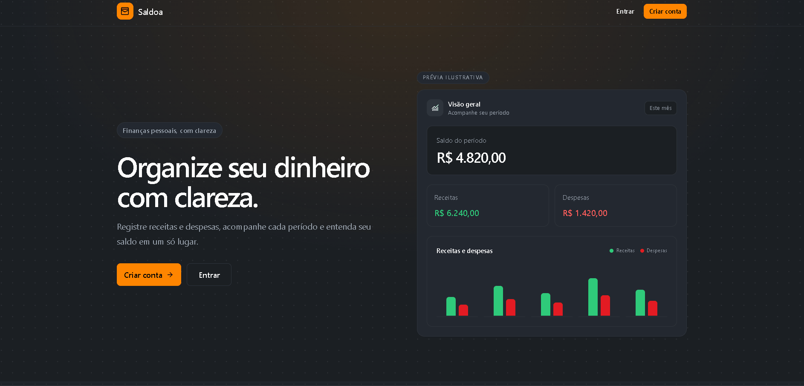
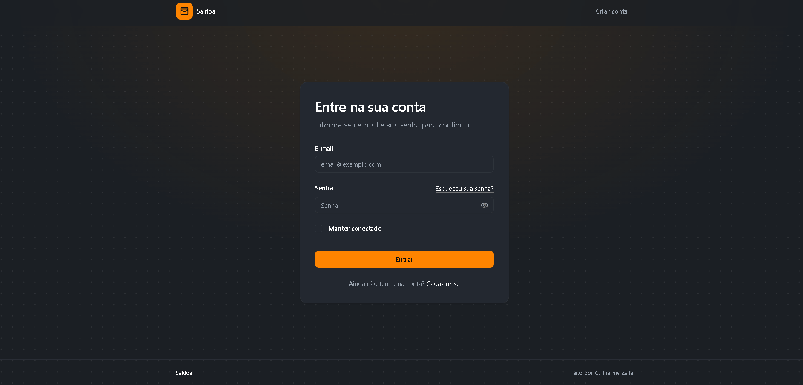
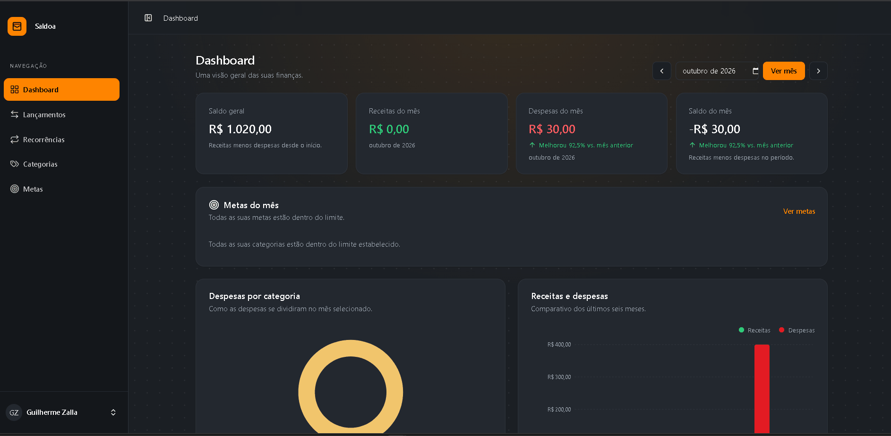
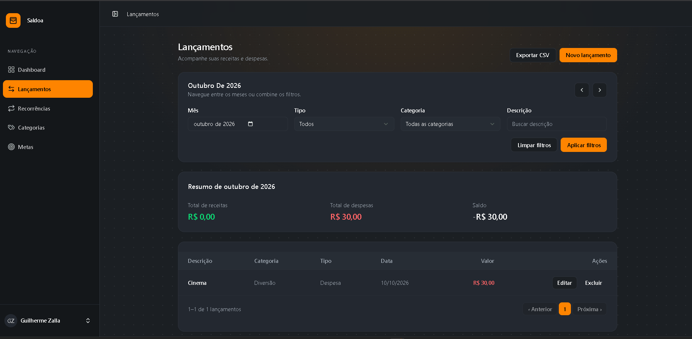
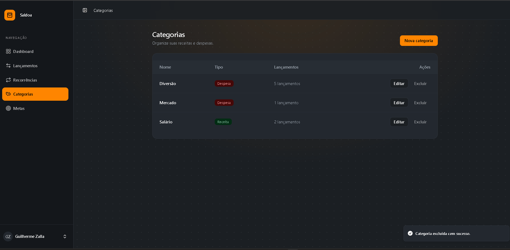
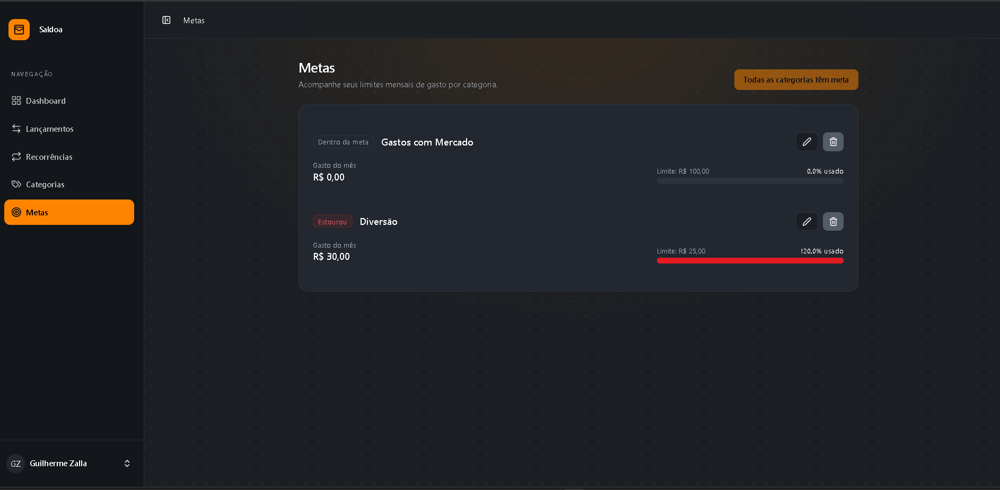

# Saldoa

O Saldoa ajuda a acompanhar o dinheiro que entra e sai. Você registra receitas e despesas, organiza tudo por categoria, define limites mensais e vê um resumo das finanças no dashboard. É um projeto de portfólio feito com Laravel, React e Inertia.

## Features da aplicação

- Criar uma conta e manter os dados separados por usuário.
- Registrar receitas e despesas, filtrar os lançamentos e exportar os resultados para CSV.
- Organizar lançamentos em categorias e definir metas mensais para categorias de despesa.
- Agendar lançamentos recorrentes e acompanhar os resumos no dashboard.
- Experimentar o app com a conta de demonstração, quando o login demo estiver habilitado.

## Tecnologias

- PHP 8.4 e Laravel 13
- React 19, Inertia.js 3 e TypeScript
- Tailwind CSS 4 e componentes shadcn/ui
- Recharts para os gráficos
- Pest para os testes
- SQLite por padrão no ambiente local; MySQL também pode ser configurado

## Rodar na sua máquina

Você precisa de PHP 8.4 com as extensões do Laravel, Composer, Node.js/npm e Git. Com SQLite, não é necessário instalar um servidor de banco de dados.

```bash
git clone https://github.com/GuilhermeZalla/react-saldoa-app.git
cd react-saldoa-app
composer install
npm install
```

Copie `.env.example` para `.env` (no PowerShell, use `Copy-Item .env.example .env`), gere a chave e prepare o banco:

```bash
php artisan key:generate
php artisan migrate --seed
```

O arquivo de ambiente padrão usa SQLite. Caso o arquivo `database/database.sqlite` não exista, crie-o antes de migrar. Para usar MySQL, configure as variáveis `DB_*` no `.env`.

Inicie a aplicação e o Vite:

```bash
composer run dev
```

Abra [http://localhost:8000](http://localhost:8000). O seeder cria dados de exemplo, incluindo a conta `demo@exemplo.com` (senha `demo1234`). O botão de acesso em um clique depende de `DEMO_LOGIN_ENABLED=true` no `.env`.

## Rodar as verificações

```bash
php artisan test
npm run check
npm run types:check
npm run build
```

O workflow do GitHub Actions também executa o setup e as verificações em pushes para `main` e em pull requests.

## Como o app é organizado

As rotas ficam em `routes/` e encaminham as requisições para controllers em `app/Http/Controllers/`. As regras de entrada ficam em Form Requests e as permissões por usuário ficam em Policies. Models e migrations representam os dados no banco. Serviços reúnem cálculos usados por mais de uma tela.

As páginas React ficam em `resources/js/pages/`, os componentes reutilizáveis em `resources/js/components/` e os tipos compartilhados em `resources/js/types/`. O Inertia conecta essas páginas às rotas Laravel, enviando os dados preparados no servidor. O Wayfinder gera funções TypeScript para chamar as rotas nomeadas.

Os testes de comportamento ficam em `tests/Feature/`; factories e seeders ajudam a preparar os dados. O agendamento de recorrências é definido em `routes/console.php`: em produção, configure o cron do Laravel Scheduler para que as ocorrências sejam criadas no horário previsto.

## Demonstração

### Tela Inicial



### Login e cadastro



### Dashboard



### Lançamentos



## Categorias



## Meta



## Deploy

O app ainda não possui uma URL pública de produção.
