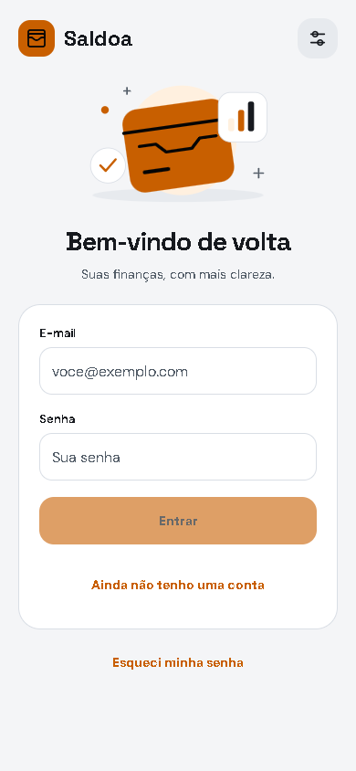
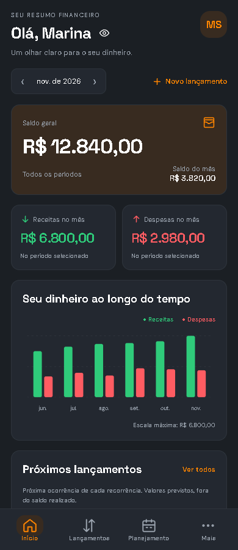
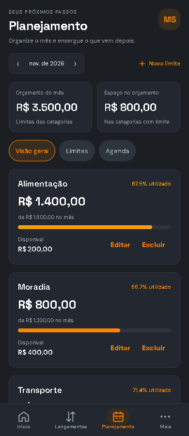

# Saldoa Mobile

A personal finance app created in **2026**, extending the Saldoa web application completed in **2025**.

**[Download the Android APK](https://github.com/GuilhermeZalla/react-saldoa-app/releases/download/v1.1.1/saldoa-android-v1.1.1.apk)** · [Release notes](https://github.com/GuilhermeZalla/react-saldoa-app/releases/tag/v1.1.1) · [Visit the web application](https://saldoa-app.duckdns.org)

Version **1.1.1** is the stable Android release with password visibility controls, tablet sign-in/sign-up layouts, a collapsible sidebar, and corrected dashboard columns. It retains the dashboard, transaction history, planning, search, pagination, and Portuguese/English support.

See the [changelog](../CHANGELOG.md) for the complete version history. The author confirmed that test8 works and approved the corrected tablet preview. Version **1.1.1**, Android version code **12**, is the current stable release; previous test builds remain in the release history. Complete native-device validation remains separate.

## Preview

<p>
  
  
  
</p>

Screenshots from the app's web preview, using sample data.

## Features

Dashboard, income and expenses, categories, spending budgets, recurring transactions, data export, and account management. Available in Portuguese and English, with light, dark, and system themes.

More screens: [Sign up](../docs/screenshots/mobile-register-expo.png) · [Transactions](../docs/screenshots/mobile-transactions-expo.png) · [Transaction form](../docs/screenshots/mobile-transaction-form-expo.png) · [Categories](../docs/screenshots/mobile-categories-expo.png) · [Recurring transactions](../docs/screenshots/mobile-recurring-expo.png) · [Account](../docs/screenshots/mobile-account-expo.png) · [Preferences in English](../docs/screenshots/mobile-preferences-en.png) · [Dashboard in English](../docs/screenshots/mobile-dashboard-en.png).

The app adapts to tablet-sized windows in portrait and landscape. Wide screens use a sidebar with direct access to finance, account, preferences, and help; narrow windows keep the four bottom tabs and the More menu. Cards use two columns where space allows. Forms remain scrollable and use a bounded, centered panel on larger screens. The existing theme, fonts, languages, and financial features are preserved.

Tablet layout: [landscape preview with sample data](../docs/screenshots/mobile-dashboard-tablet-expo.png).

The tablet improvements are included in the stable **1.1.1** APK (versionCode 12), available as a [regular release](https://github.com/GuilhermeZalla/react-saldoa-app/releases/tag/v1.1.1). [Download the APK](https://github.com/GuilhermeZalla/react-saldoa-app/releases/download/v1.1.1/saldoa-android-v1.1.1.apk). It adds show/hide password controls, wider sign-in/sign-up layouts, a sidebar that collapses to icons, and dashboard cards that fill both columns without wrapping into half-width rows. It uses the same signing certificate as `test8` and can update the previous installation without uninstalling. The web preview passed 24 theme/language/width combinations; 528 Yoga layout checks covered fractional widths, densities, and font scaling. Native rotation, keyboard behavior, dialogs, and guide downloads still need a device check. See [project status](../docs/STATUS.md) for the build and verification details. Google Play and monetization remain pending.

## Install

1. Download the APK from GitHub Releases on your Android phone.
2. Allow installation from your browser or file manager if Android asks.
3. Open Saldoa and create an account, or sign in with your account from the hosted website.
4. Use it over Wi-Fi or mobile data.

The APK connects to the public API. Laravel does not need to be running on your computer. Local development accounts and data are separate from the AWS deployment.

The APK supports **Android ARM64** and uses a **debug signing key**. It is available for direct installation and is not published on Google Play. Distribution signing and store publishing are outside the scope of this release.

Password recovery and email-based account deletion use the website. Gmail SMTP is configured, and both complete flows were confirmed by the author.

## Run the source code

From the repository root, using PowerShell:

```powershell
if (!(Test-Path mobile/.env)) {
    Copy-Item mobile/.env.example mobile/.env
}
cd mobile
npm ci
```

Keep any existing environment configuration. To use the public server, set these values in `mobile/.env`:

```dotenv
EXPO_PUBLIC_API_URL=https://saldoa-app.duckdns.org
EXPO_PUBLIC_WEB_URL=https://saldoa-app.duckdns.org
EXPO_PUBLIC_API_URL_DEMO=
```

Run `npm start`. Use an Expo Go version compatible with this project on your phone, or run `npm run web` to open the browser preview.

For a local API, use your computer's LAN IP and port 8000 for both URLs. Start Laravel from the repository root with `php artisan serve --host=0.0.0.0 --port=8000`, and connect the phone and computer to the same Wi-Fi network.

## Build an APK

Requires Android Studio, Android SDK, and Java. From `mobile`, to use the public API:

```powershell
$env:EXPO_PUBLIC_API_URL = 'https://saldoa-app.duckdns.org'
$env:EXPO_PUBLIC_WEB_URL = 'https://saldoa-app.duckdns.org'
$env:EXPO_PUBLIC_API_URL_DEMO = ''
npm run apk:local -- --public-api
```

The output is `android/app/build/outputs/apk/release/app-release.apk`. For local testing with a private HTTP API, configure the LAN address in `.env` and run `npm run apk:local` without the public API flag. Changing the API URL requires a new build.

## Checks

```powershell
npm test
npm run types:check
npm run lint
```

See [MOBILE_API.md](../docs/MOBILE_API.md) for API contracts and security notes in Portuguese. The [main README](../README.md) introduces the complete project.
